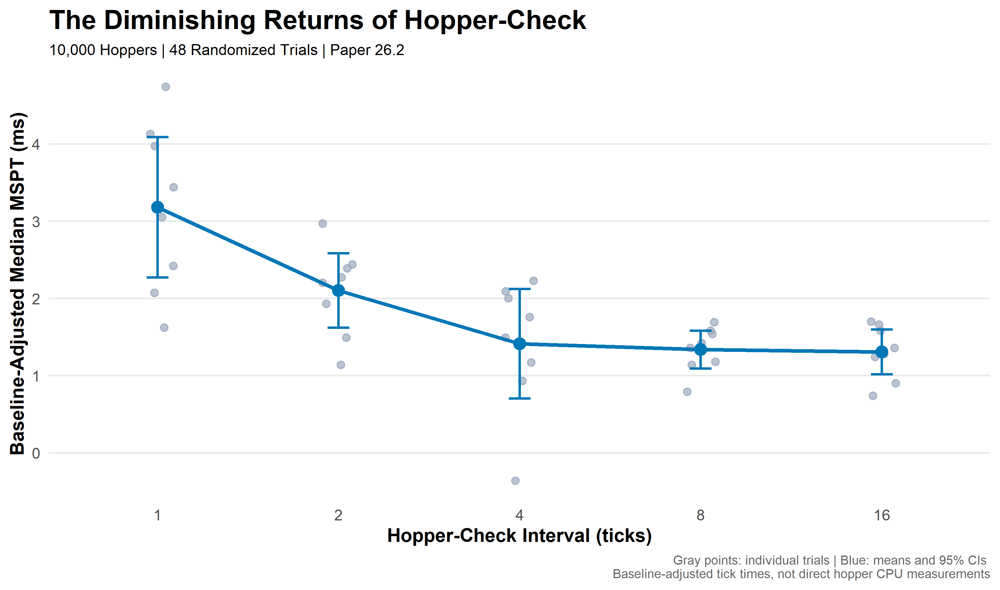
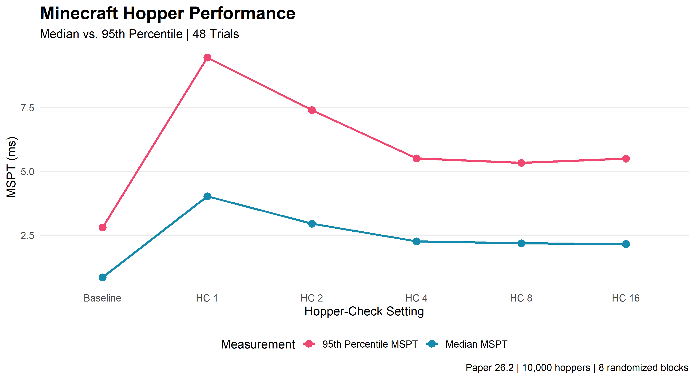
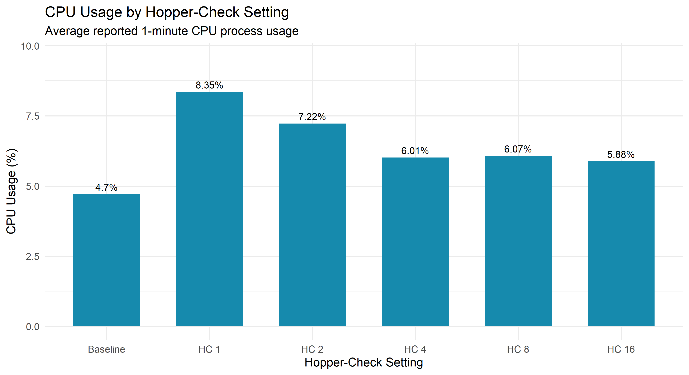
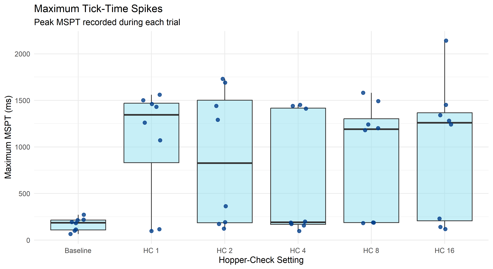

# Minecraft Hopper Performance Research

### The Diminishing Returns of Hopper-Check Intervals

**How much server performance do we actually gain by making hoppers check less frequently?**

I tested 10,000 hoppers on a Paper server across 48 randomized trials, then analyzed the results in R to see how much different hopper-check settings actually help.



**[Full Experimental Methodology](METHODS.md)**

## Abstract

Hoppers are a big part of technical Minecraft. They're used in farms, sorting systems, and storage systems, but having thousands of them loaded can put a lot of strain on a server.

Paper lets server administrators change how frequently hoppers check for items. Increasing the hopper-check interval can improve performance, but it also has the potential to affect how hoppers behave. I wanted to see if doubling the interval actually gives a similar improvement each time, or if the benefits start to level off.

I conducted a randomized complete block experiment with 10,000 hoppers and five hopper-check settings: 1, 2, 4, 8, and 16. I tested each setting eight times, along with eight baseline trials without hoppers, for 48 trials total.

The mean median MSPT dropped from 4.024 ms at HC 1 to 2.258 ms at HC 4. Increasing the interval to HC 8 and HC 16 produced much smaller improvements. The results show a diminishing-returns pattern, although the sample size and variation between trials make it difficult to say exactly how much better neighboring settings are.

**The main question isn't just whether increasing hopper-check improves performance. It's how much performance we're gaining compared to how much hopper responsiveness we're giving up.**

---

## 1. Research Question

Increasing hopper-check means hoppers check for items less frequently. This can reduce the amount of work the server has to do, but doubling the interval doesn't necessarily mean we're cutting the processing time in half.

For example, going from HC 1 to HC 2 doubles the interval. Going from HC 8 to HC 16 also doubles it. I wanted to find out whether those two changes produce similar improvements.

### Hypothesis

I expected server performance to improve the most at lower hopper-check settings. As the interval increased, I expected the additional improvements to get smaller, producing a diminishing-returns curve rather than a linear decrease in processing time.

---

## 2. Experimental Setup

| Parameter | Configuration |
|---|---|
| Minecraft | Java Edition |
| Server Software | Paper 26.2 |
| Hosting | PebbleHost |
| Hopper Population | 10,000 |
| Hopper-Check Settings | 1, 2, 4, 8, 16 |
| Hopper-Transfer Setting | 8 |
| Baseline | No test hoppers |
| Randomized Blocks | 8 |
| Total Trials | 48 |
| Performance Monitoring | Spark |
| Statistical Analysis | R |

### Experimental Design

I used a randomized complete block design. Each block contained all six conditions:

- Baseline (no hoppers)
- HC 1
- HC 2
- HC 4
- HC 8
- HC 16

I used R to randomize the order of the six conditions within each block. With eight blocks, that gave me eight measurements per condition and 48 trials overall.

The point of randomizing the order was to reduce the chance that changes in server performance over time would consistently favor one setting.

### Testing Procedure

Each trial followed the same steps:

1. Set the assigned hopper-check interval.
2. Restart the Paper server so the change would take effect.
3. Give the server approximately 30 seconds to stabilize.
4. Run a 60-second Spark profiling session.
5. Record the available performance measurements.
6. Move on to the next condition in the randomized order.

For baseline trials, I removed the 10,000 test hoppers.

### Measurements

The main measurement I used was **median milliseconds per tick (MSPT)**. I also recorded:

- 95th-percentile MSPT
- Maximum MSPT
- Reported process CPU usage

MSPT is how long the server takes to process a tick. A lower MSPT generally means the server has more processing capacity available.

**Measurement limitation:** I recorded Spark's summary statistics during each experiment, but I haven't independently verified that their reporting windows matched the 60-second profiling sessions exactly. Because of that, these are measurements of overall server performance under the tested conditions, not direct measurements of hopper-only CPU usage.

---

## 3. Experimental Results

### 3.1 Overall Server Performance

These are the arithmetic means of the eight trial-level measurements for each condition.

| Condition | Mean Median MSPT | Mean 95th-Percentile MSPT |
|---|---:|---:|
| Baseline | 0.844 ms | 2.80 ms |
| HC 1 | 4.024 ms | 9.46 ms |
| HC 2 | 2.948 ms | 7.40 ms |
| HC 4 | 2.258 ms | 5.50 ms |
| HC 8 | 2.181 ms | 5.33 ms |
| HC 16 | 2.151 ms | 5.50 ms |



The biggest improvements happened between HC 1 and HC 4. After HC 4, the curve started to flatten out.

HC 16 had the lowest mean median MSPT, while HC 8 had the lowest mean 95th-percentile MSPT of the hopper conditions. But the differences between the higher settings were pretty small compared to how much the results varied between trials.

### 3.2 Baseline-Adjusted Performance

Every block included a baseline trial with no test hoppers. I subtracted that block's baseline median MSPT from the hopper-condition measurements to get a baseline-adjusted value.

| Hopper-Check | Mean Baseline-Adjusted MSPT |
|---|---:|
| HC 1 | 3.180 ms |
| HC 2 | 2.104 ms |
| HC 4 | 1.414 ms |
| HC 8 | 1.338 ms |
| HC 16 | 1.308 ms |

These values show differences in overall server tick time. They don't tell us the exact amount of CPU time spent processing individual hoppers.

### 3.3 Diminishing Returns

I compared how much mean median MSPT dropped each time the hopper-check interval doubled.

| Hopper-Check Change | Reduction in MSPT |
|---|---:|
| 1 → 2 | 1.076 ms |
| 2 → 4 | 0.690 ms |
| 4 → 8 | 0.076 ms |
| 8 → 16 | 0.030 ms |

Going from HC 1 to HC 2 gave a much bigger improvement than going from HC 8 to HC 16, even though both changes doubled the interval.

That is the diminishing-returns pattern I was looking for. However, just because two settings have similar averages doesn't mean we've proven they perform the same.

### 3.4 CPU Usage

I also recorded Spark's reported one-minute process CPU usage.

| Condition | Mean Reported CPU Usage |
|---|---:|
| Baseline | 4.70% |
| HC 1 | 8.35% |
| HC 2 | 7.22% |
| HC 4 | 6.01% |
| HC 8 | 6.07% |
| HC 16 | 5.88% |



CPU usage generally went down as hopper-check increased, but not perfectly. HC 8 actually had a slightly higher average CPU percentage than HC 4.

These are process-wide CPU measurements, and the reporting windows may overlap. They shouldn't be treated as measurements of CPU usage from hoppers alone.

### 3.5 Maximum Tick-Time Spikes

I recorded maximum MSPT to look for unusually slow server ticks.



Some trials had maximum MSPT values above 1,000 milliseconds. I didn't independently identify what caused those spikes, so I can't say they were caused by the hopper-check settings. Other server processes could have contributed.

Because of that, I treated maximum MSPT as a diagnostic measurement rather than the main way of comparing settings.

---

## 4. Statistical Analysis

I analyzed the results in R. Since each randomized block included every condition, the statistical analysis accounted for the block structure instead of treating all the measurements as unrelated.

### 4.1 Hopper-Check-Only Analysis

First, I ran a Friedman test using only the five hopper-check conditions, leaving out the no-hopper baseline.

**Friedman test:** χ²(4) = 18.6, p = 0.0009417

The result was statistically significant (p < 0.001), meaning at least some hopper-check settings differed in observed median MSPT.

The averages showed diminishing improvements as hopper-check increased, but this overall test doesn't tell us exactly which individual settings were different. The Holm-adjusted comparisons between neighboring settings also weren't statistically significant.

So the results support hopper-check affecting performance under these test conditions, but there's still uncertainty about the exact improvement from one setting to the next.

### 4.2 Overall Differences

I also ran a repeated-measures ANOVA across all six conditions, including the no-hopper baseline.

**ANOVA:** F(5, 35) = 22.49, p = 4.9 × 10⁻¹⁰

I then ran a Friedman test as a nonparametric alternative.

**Friedman test:** χ²(5) = 29.00, p = 0.0000232

Both tests found statistically significant differences among the six conditions. However, since these tests included the no-hopper baseline, that significance alone doesn't prove which hopper-check settings differ from each other.

### 4.3 Adjacent Hopper-Check Comparisons

I used paired t-tests to compare neighboring hopper-check settings. I then applied a Holm correction to account for making multiple comparisons.

| Comparison | Mean Difference | Holm-Adjusted p-value |
|---|---:|---:|
| HC 1 vs HC 2 | 1.076 ms | 0.149 |
| HC 2 vs HC 4 | 0.690 ms | 0.208 |
| HC 4 vs HC 8 | 0.076 ms | 1.000 |
| HC 8 vs HC 16 | 0.030 ms | 1.000 |

None of these comparisons were statistically significant at α = 0.05 after the Holm correction.

That doesn't mean the settings are equivalent. For example, the HC 8 versus HC 16 comparison had an unadjusted 95% confidence interval of approximately −0.421 to 0.481 ms. The observed mean difference was only 0.030 ms, but the confidence interval is wide enough that we can't rule out a meaningful difference with the data we have.

---

## 5. Discussion

The results suggest that increasing hopper-check has diminishing returns. At the lower settings, increasing the interval produced substantial reductions in MSPT. Once I got to HC 4, additional improvements were much smaller.

This matters because lower MSPT isn't the only thing that matters on a Minecraft server. Hoppers are part of larger redstone systems. Farms, item sorters, storage systems, and other machines may depend on their timing.

If we make hoppers check less often, we might reduce processing time while also changing how certain contraptions work. The question is whether the additional performance is worth that tradeoff.

### Performance Versus Functionality

The goal shouldn't necessarily be to get the lowest MSPT possible, regardless of what it does to the game. Ideally, a server should reduce unnecessary processing while keeping technical mechanics reliable.

In this experiment, HC 4, HC 8, and HC 16 had fairly similar mean median MSPT values. But I'd need to test actual item transfers and working machines before saying those settings perform similarly in a real server environment.

### Study Limitations

There are several limitations to this experiment:

- I tested one Paper server environment.
- I used one hopper population and arrangement.
- The main measurements describe overall MSPT, not hopper-specific CPU time.
- I restarted the server between configuration changes.
- I only allowed approximately 30 seconds for stabilization.
- Spark's summary reporting windows weren't independently verified against the profiling windows.
- Each condition was tested eight times.
- I didn't independently investigate the maximum-MSPT spikes.
- I didn't test whether working hopper contraptions functioned correctly under each setting.

These limitations matter when trying to apply the results to production servers with different farms, plugins, player counts, or hardware.

---

## 6. Conclusion

I tested five hopper-check settings using 10,000 hoppers and 48 randomized trials on Paper 26.2.

The biggest drop in mean median MSPT happened between HC 1 and HC 4. Going from HC 4 to HC 8 and then HC 16 produced much smaller additional improvements. The 95th-percentile MSPT and reported CPU usage generally followed a similar pattern, with most of the improvement happening at the lower intervals.

A Friedman test using only the five hopper-check settings found a statistically significant overall difference in median MSPT (χ²(4) = 18.6, p = 0.0009417). However, none of the comparisons between neighboring settings stayed statistically significant after the Holm correction.

Overall, the results are consistent with diminishing returns, but they don't prove that the higher settings are equivalent or that one hopper-check value is best for every server.

**The bigger question is whether the extra performance is worth changing how hoppers behave. Ideally, we'd optimize the processing itself without sacrificing vanilla mechanics.**

---

## 7. Future Investigations

This is part of a larger project investigating Minecraft server performance and technical game mechanics. Some experiments I'd like to do next include:

- Profiling the specific functions responsible for hopper processing.
- Comparing empty and idle hoppers with hoppers actively transferring items.
- Testing hopper-transfer settings separately.
- Comparing different hopper arrangements and populations.
- Measuring performance with actual redstone and storage machines.
- Testing item throughput and whether the machines still behave correctly.
- Repeating experiments on different Paper versions and server environments.
- Running more trials to reduce statistical uncertainty.

---

## Data, Code, and Reproducibility

The repository contains the recorded measurements, R analysis scripts, and figures used for this experiment.

### Repository Structure

```text
Minecraft-Hopper-Performance-Research/
├── README.md
├── METHODS.md
├── data/
│   ├── hopper_randomized_trials.csv
│   └── hopper_complete_data.csv
├── analysis/
│   ├── hopper_analysis.R
│   └── hopper_additional_analysis.R
├── figures/
│   ├── hopper_diminishing_returns.png
│   ├── median_vs_p95.png
│   ├── cpu_usage.png
│   └── max_mspt_spikes.png
└── profiles/
    └── [available Spark profiles]
```

The `data/` folder contains the 48 randomized trials and additional recorded Spark statistics. The `analysis/` folder contains the R scripts used for statistical tests and figures. The `figures/` folder contains the graphs, and any available original Spark profiles can go in `profiles/`.

`METHODS.md` contains the full testing procedure so other people can reproduce the experiment.

**Reproducibility note:** The repository structure should match the files actually uploaded to GitHub. Original measurements should be kept unchanged unless any modifications are clearly documented.

---

*Independent research into Minecraft server performance, redstone systems, and technical game mechanics.*
